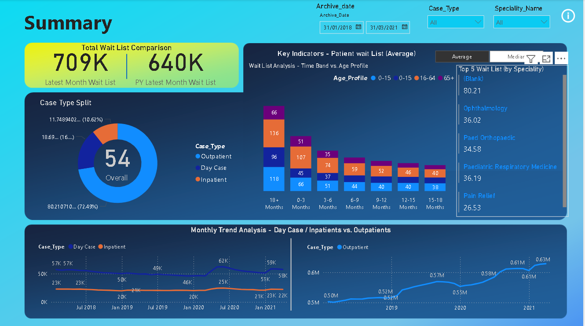
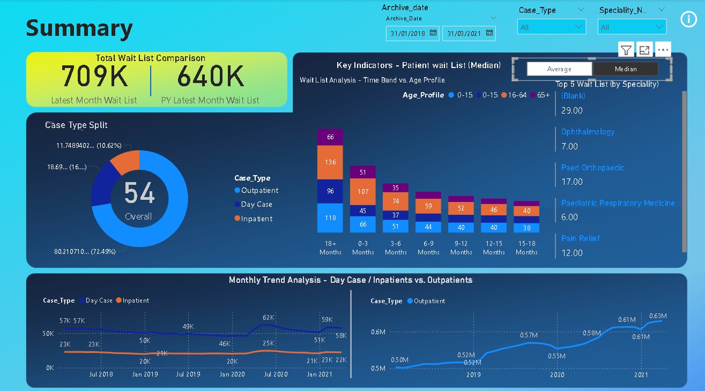
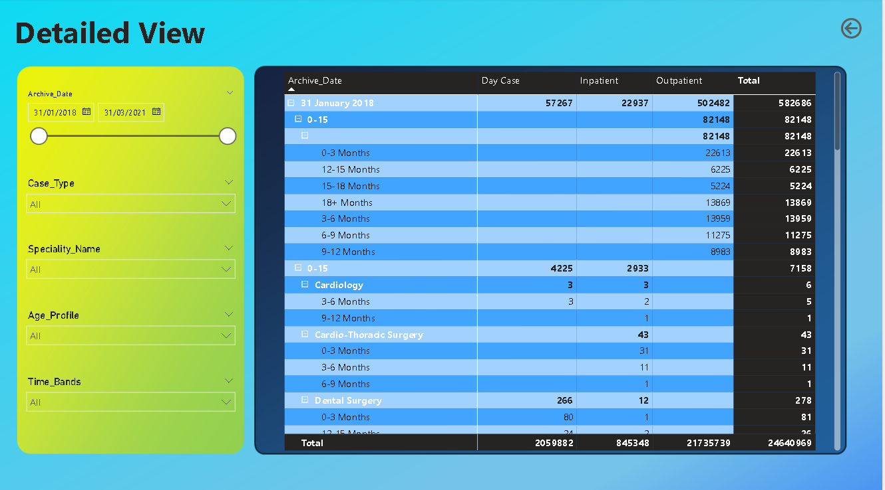

# Healthcare Waiting List Dashboard (Power BI)

An interactive Power BI report on UK patient waiting lists, **January 2018 to March 2021**, split by case type (outpatient, day case, inpatient), age profile, speciality and time band.

The latest month's waiting list is **709K**, about **11% higher** than the same month a year earlier (640K).

**Tools:** Power BI Desktop, Power Query, DAX measures

## What the dashboard answers

- How big is the waiting list now compared with a year ago?
- Which case types, age groups and specialities make up the list?
- How long have patients been waiting (time bands from 0-3 months to 18+ months)?
- How has each list moved month by month?

## Report pages

### 1. Summary



- **Filters:** date range (Archive_date), case type and speciality.
- **Headline card:** latest month waiting list against the same month a year earlier.
- **Key indicators:** waiting list by time band, split by age profile (0-15, 16-64, 65+), with a switch between **Average** and **Median**.
- **Top 5 by speciality:** also follows the Average / Median switch.
- **Case type split:** outpatient, day case and inpatient shares.
- **Monthly trends:** day case and inpatient on one chart, outpatients on their own.

The same page in Median view:



### 2. Detailed View



An expandable table for checking the numbers behind the Summary: archive date, then age profile, speciality and time band, with day case, inpatient, outpatient and total columns. It has its own filters for date, case type, speciality, age profile and time band.

### 3. DrillDown (hidden page)

lets you explore deeper levels of a data hierarchy within the same chart or visual without leaving the page

## Data and model

- **Source:** [dataset name, link and licence]
- **Period:** 31 January 2018 to 31 March 2021 (month-end archive dates)

| Table | Purpose |
|---|---|
| `All_Data` | The waiting list records |
| `Mapping_Specialty` | Mapping table for speciality names |
| `Calculation Method` | Small table behind the Average / Median switch |

## Data preparation

- **Age profile labels.** `0-15` appeared twice in the age profile column because one version had an extra space at the end. That split the age group into two series in the Summary chart and two rows in the Detailed View. I applied **Trim** to the `Age_Profile` column in Power Query, so there are now three age groups: 0-15, 16-64 and 65+.
- **Check after the fix.** The totals did not change: January 2018 is still 582,686 and the grand total in the Detailed View is still 24,640,969, so no rows were lost.

## How to read the numbers

- **Waiting list:** [confirm: number of patients on the list at each month-end, per record]
- **Average and Median:** [confirm what they measure, for example average patients per record, not waiting time in weeks]

Average and median can differ a lot. In the Top 5 view, Ophthalmology shows 36.02 on Average and 7.00 on Median, which is why the page lets you switch between them.

## Key figures

| Measure | Value |
|---|---|
| Latest month waiting list | 709K |
| Same month a year earlier | 640K |
| January 2018 total | 582,686 (502,482 outpatient, 57,267 day case, 22,937 inpatient) |
| Outpatient list, January 2018 to the end of the period | from about 502K to about 0.63M, roughly a quarter higher |
| Share of the summed monthly counts | about 88% outpatient, 8% day case, 3% inpatient |

Outpatients are shown on their own chart because their list is about ten times the size of the day case and inpatient lists, and would flatten them on one scale.

## Limitations and known issues

- **Totals add up monthly counts.** The grand total in the Detailed View (24.6M) sums the monthly lists across the date range, so it is not a count of different patients.
- **Missing specialities.** Some records, mostly outpatient, have no speciality and show as `(Blank)`. They are included in totals but cannot be attributed to a speciality.
- **Period.** The data ends in March 2021 and includes the COVID-19 pandemic. The dashboard describes the lists and does not try to explain why they moved.
- **Learning project.** Built from a public dataset as a portfolio project, so the findings should not be treated as official statistics.

## Credits

- **Dataset:** [name and link]
- **Built following:** a video tutorial [title and link]
- **What I added myself:** found and fixed the duplicate `0-15` age label (see Data preparation) and checked the totals afterwards. 


## Repository structure

```
.
├── healthcare_waitlist.pbix
├── data/
│   ├── impatient/
│   │   ├── 
│   ├── outpatient/
│   └── Mapping_Specialty.csv
├── dax_measures/
├── images/
│   ├── summary_average.png
│   ├── summary_median.png
│   └── detailed_view.png
└── README.md
```

## Open it yourself

Open `healthcare_waitlist.pbix` in Power BI Desktop (free, Windows). If the data does not load, point the data source at the file in `data/` under Transform data, then Data source settings.
